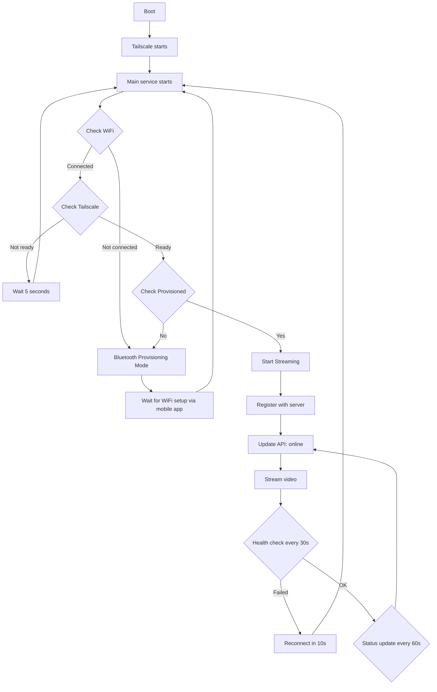

# CrowdCount Counter - Quick Start Guide

**One-command setup for Raspberry Pi Zero 2W with Global Shutter Camera**

## Prerequisites

- Raspberry Pi Zero 2W (or similar)
- Raspberry Pi Global Shutter Camera
- Fresh Raspberry Pi OS installation (Bookworm or later)
- Internet connection
- SSH or direct terminal access

## One-Command Setup

Run this single command to install and configure everything:

```bash
cd /home/pi/crowdcount-counter
./setup_all.sh
```

This script will automatically:
- ✓ Install all system dependencies (FFmpeg, camera libraries, Bluetooth, etc.)
- ✓ Install and configure Tailscale VPN
- ✓ Enable Tailscale to start on boot
- ✓ Enable Bluetooth for WiFi provisioning
- ✓ Install Python dependencies
- ✓ Create device configuration file from template
- ✓ Install and enable the main CrowdCount service
- ✓ Configure everything to auto-start on boot

**Total setup time: ~5-10 minutes** (depending on internet speed)

## After Setup

### Step 1: Configure Your Device

Edit the device configuration file:

```bash
nano /home/pi/crowdcount-counter/src/counter-stream/device-info.conf
```

**Required settings:**

```ini
DEVICE_ID=crowdcount1           # Change to your unique device ID
SERVER_IP=100.72.64.80          # Change to your server's Tailscale IP
PASSWORD=your_password_here     # Your API password for status updates
```

**Optional settings:**
```ini
WIDTH=640                       # Video width (default: 640)
HEIGHT=480                      # Video height (default: 480)
FPS=30                          # Frame rate (default: 30)
RTSP_PORT=8554                  # RTSP port (default: 8554)
API_URL=https://api.crowdcount.tech  # API URL (default)
```

Save the file (Ctrl+O, Enter, Ctrl+X).

### Step 2: Authenticate Tailscale

```bash
sudo tailscale up
```

Follow the link displayed to authenticate with your Tailscale account.

### Step 3: Reboot

```bash
sudo reboot
```

## After Reboot - What Happens Automatically

The device will automatically:

1. **Tailscale** starts and connects to VPN
2. **Main service** starts and checks:
   - WiFi connectivity (multiple detection methods)
   - Tailscale connectivity
   - Device provisioning status
3. **Decision logic**:
   - **No WiFi?** → Enters Bluetooth provisioning mode (use mobile app to configure WiFi)
   - **WiFi + Tailscale connected?** → Starts camera streaming to server
4. **While streaming**:
   - Sends video to server via RTSP
   - Updates API status to "online" every 60 seconds
   - Performs server health checks every 30 seconds
   - Automatically reconnects if connection is lost

## Monitoring

### Check Service Status

```bash
sudo systemctl status crowdcount-main
```

Expected output when running:
```
● crowdcount-main.service - CrowdCount Main Service (Provisioning + Streaming)
   Loaded: loaded (/etc/systemd/system/crowdcount-main.service; enabled)
   Active: active (running) since ...
```

### View Live Logs

```bash
sudo journalctl -u crowdcount-main -f
```

Expected log output when streaming:
```
Status Check:
  WiFi Connected: True (YourSSID)
  Tailscale: True (100.x.x.x)
  Provisioned: True
  Config Exists: True

Decision: Starting streaming
✓ Device registered: crowdcount1
✓ Device status updated to 'online'
✓ Hardware encoder started (2.5 Mbps)
Streaming: 5.0s elapsed, encoder running at 30 fps
```

### Check Tailscale Status

```bash
tailscale status
```

Shows all devices in your Tailnet and your device's IP.

## Troubleshooting

### Service Not Starting

```bash
# Check for errors
sudo journalctl -u crowdcount-main -n 50

# Restart manually
sudo systemctl restart crowdcount-main
```

### Camera Not Detected

```bash
# Check camera
libcamera-hello --list-cameras

# Should show your Global Shutter Camera
```

### Tailscale Not Connected

```bash
# Check Tailscale status
sudo systemctl status tailscaled

# Re-authenticate
sudo tailscale up

# View Tailscale logs
sudo journalctl -u tailscaled -f
```

### WiFi Detection Issues

The system uses 4 fallback methods for WiFi detection:
1. NetworkManager (nmcli)
2. iwgetid
3. Default route check
4. wpa_supplicant

If all fail, check:
```bash
# Manual WiFi check
nmcli dev status
iwgetid
ip route show default
```

### Configuration Issues

```bash
# Verify configuration file exists
cat /home/pi/crowdcount-counter/src/counter-stream/device-info.conf

# Re-create from template if needed
cd /home/pi/crowdcount-counter/src/counter-stream
cp device-info.conf.template device-info.conf
nano device-info.conf
```

## Services That Auto-Start on Boot

After running `setup_all.sh`, these services are enabled:

| Service | Purpose | Status Command |
|---------|---------|----------------|
| `tailscaled` | VPN connectivity | `sudo systemctl status tailscaled` |
| `bluetooth` | WiFi provisioning | `sudo systemctl status bluetooth` |
| `crowdcount-main` | Main orchestrator | `sudo systemctl status crowdcount-main` |

## Managing the Main Service

```bash
# Start
sudo systemctl start crowdcount-main

# Stop
sudo systemctl stop crowdcount-main

# Restart
sudo systemctl restart crowdcount-main

# Disable auto-start
sudo systemctl disable crowdcount-main

# Re-enable auto-start
sudo systemctl enable crowdcount-main

# View logs (live)
sudo journalctl -u crowdcount-main -f

# View logs (last 100 lines)
sudo journalctl -u crowdcount-main -n 100
```

## What the Main Service Does



## Production Deployment

For production devices, create a device identity file during manufacturing:

```bash
sudo nano /boot/firmware/device-identity.conf
```

Content:
```ini
[DEFAULT]
DEVICE_ID=CC-001
DEVICE_SECRET=your-random-secret-here
MANUFACTURING_DATE=2024-01-15
MODEL=counter-v2
```

This file persists across SD card reflashes.

## Re-running Setup

The setup script is idempotent - you can run it multiple times safely:

```bash
./setup_all.sh
```

It will:
- Skip already-installed packages
- Preserve existing configuration files
- Update/reinstall the service if needed

## Next Steps

1. ✅ Run `./setup_all.sh`
2. ✅ Configure `device-info.conf`
3. ✅ Authenticate Tailscale
4. ✅ Reboot
5. ✅ Monitor logs to verify streaming

**Your device is now fully configured to auto-start on boot!**

## Support

For detailed documentation, see:
- `INSTALL.md` - Detailed installation guide
- `MAIN_SERVICE.md` - Service architecture documentation
- `README.md` - Project overview

For issues:
- Check logs: `sudo journalctl -u crowdcount-main -f`
- Verify configuration: `cat src/counter-stream/device-info.conf`
- Test camera: `libcamera-hello --list-cameras`
- Test Tailscale: `tailscale status`
